# Stage 2: Taalas HC1 & HC2 Hardwired LLM Inference ASIC — Cycle-Accurate Microarchitecture Specification

**Document ID**: `TAALAS-HC1-HC2-MICROARCH-SPEC-V1.0`  
**Target Silicon**: Taalas HC1 (TSMC N6 6nm, 815 mm², 53B Transistors) & Taalas HC2 (TSMC N4P 4nm, MXFP4 + Disaggregated 3D SRAM)  
**Scope**: Complete Bit-Exact, Cycle-Accurate Hardware Specification for All 14 RTL IP Modules (`M1`–`M14`), Memory Banking, GF($2^4$) Swizzling, 72-bit SECDED ECC, Datapath Formats, FSMs, Pipeline Schedules, and CSR Address Maps.

---

## 1. System-Level Architecture & Physical Floorplan Overview

### 1.1 Architectural Paradigm: "The Model IS the Silicon"
Conventional GPU accelerators (e.g., NVIDIA H100/B200) suffer from the von Neumann memory wall during autoregressive LLM decode (batch size $B=1$): generating a single token for an 8-billion-parameter model requires fetching 8–16 GB of weights from off-chip HBM3e, consuming $\sim 400\text{--}700\text{ W}$ while achieving only $100\text{--}300\text{ tok/s/user}$.

The **Taalas HC1** architecture eliminates off-chip weight movement entirely by embedding the complete frozen parameter set of an LLM (specifically **Llama-3.1-8B**, $8.03 \times 10^9$ parameters) directly into custom **Two-Mask Via-Programmable Metal ROM (`M1`)** tightly coupled to **Multiplierless Shift-Add/CSD Vector-Matrix Multiply (VMM) Arrays (`M2`)**:
1. **Zero HBM / Zero Off-Chip DRAM**: All $7.50\text{ B}$ transformer layer weights and $0.53\text{ B}$ embedding/LM-head weights reside permanently on a single $815\text{ mm}^2$ reticle-limit TSMC N6 die ($53 \times 10^9$ transistors).
2. **Two-Mask Silicon Customization**: Base silicon wafers (FEOL transistors, Metal-1, and upper routing layers) are pre-manufactured as generic *Master Slices*. Customizing a wafer for a new LLM checkpoint requires modifying only **two photolithography masks** (Metal-2 and Via-2/Metal-3), cutting tape-out-to-silicon turnaround to $\sim 2\text{ months}$ at $<\$500\text{K}$ NRE.
3. **1 Transistor = 1 Weight $\times$ 1 Op**: Zero weights have no Via-2 connection and consume zero dynamic switching power; non-zero 3-bit base weights are hardwired into Canonical Signed Digit (CSD) shift-and-add trees, assisted by a sparse 6-bit outlier channel path (`3b/6b mixed quantization`).
4. **On-Die 6T SRAM Overlay (`256 MB`)**: Dynamic state—specifically the Grouped-Query Attention (GQA) KV-cache (`M6`) and rank-$r$ Low-Rank Adaptation (LoRA) weights (`M7`)—resides in 16-banked, SECDED-protected 6T SRAM macros (`M5`) distributed alongside the compute tiles.
5. **Spatial Token-Pipe Execution**: The 32 Llama-3.1 transformer layers are laid out spatially in a $4 \times 8$ tile grid connected by a credit-based wormhole daisy-chain NoC (`M12`). An activation vector enters Layer 0 and streams continuously through Layers $0 \to 31$, completing a full 8B-parameter forward pass in **$58.8\ \mu\text{s}$ ($17,000\text{ tokens/sec/user}$ at $1.25\text{ GHz}$)** while consuming **$\sim 220\text{ W}$ ($\sim 12.94\text{ mJ/token}$)**.

### 1.2 Taalas HC1 vs. HC2 Architectural Comparison

| Architectural Feature | Taalas HC1 (1st Generation) | Taalas HC2 (2nd Generation) |
| :--- | :--- | :--- |
| **Foundry Process Node** | TSMC N6 (7nm-class EUV, 6nm optical shrink) | TSMC N4P (4nm-class high-density EUV) |
| **Die Area & Transistor Count** | $815\text{ mm}^2$ (reticle limit), $53.0 \times 10^9$ transistors | $\sim 800\text{ mm}^2$ compute die + disaggregated 3D SRAM die |
| **Hardwired Weight Storage** | Metal-2 / Via-2 / Metal-3 Via-Programmable ROM (`M1`) | Dual-Via High-Density Metal-2/Via-2/Metal-3/Via-3 ROM |
| **Primary Compute Datatype** | **3-bit Base (CSD) + 6-bit Sparse Outlier** (`M2`) | **OCP MXFP4 (`E2M1` + shared `E8M0` block scale)** (`M3`) |
| **Activation & Accumulation** | `INT8` / `FP16` activations, `INT24` -> `FP32` group acc | `MXFP4` / `FP8 (E4M3)` activations, exact integer-aligned tree + `FP32` |
| **Group Scale Granularity** | $G = 64$ or $128$ with `FP16`/`BF16` scale $s_g$ & zero-point $z_g$ (`M4`) | $G = 32$ OCP microscaling block with shared 8-bit `E8M0` power-of-2 scale |
| **On-Die / Package SRAM** | $256\text{ MB}$ monolithic on-die 6T SRAM (`M5`) | $64\text{ MB}$ on-compute-die L1 + $512\text{ MB}\text{--}2\text{ GB}$ 3D-stacked SRAM |
| **KV-Cache Format** | `INT4` asymmetric quantized GQA 4:1 ring buffer (`M6`) | `MXFP4` / `INT4` multi-slot paged/ring KV controller |
| **Model Adaptability** | Hardwired base weights + SRAM-backed rank-$r$ LoRA (`M7`) | Hardwired MXFP4 base + SRAM LoRA + Mixture-of-Experts (MoE) routing |
| **Core Clock Frequency** | $1.25\text{ GHz}$ ($T_{\text{clk}} = 800\text{ ps}$) | $1.60\text{ GHz}$ ($T_{\text{clk}} = 625\text{ ps}$) |
| **Single-User Decode Speed** | **$17,000\text{ tok/s}$** ($58.8\ \mu\text{s/tok}$ on Llama-3.1-8B) | **$>28,000\text{ tok/s}$** (8B) or **$10,000+\text{ tok/s}$** (70B multi-die) |
| **Chip TDP & Energy/Token** | $\sim 220\text{ W}$ typical ($\sim 12.94\text{ mJ/token}$) | $\sim 250\text{ W}$ typical ($\sim 8.9\text{ mJ/token}$ on 8B equivalent) |

---

## 2. Global Clock, Reset, Numeric Formats & End-to-End Latency Budget

### 2.1 Clock & Reset Conventions
- **Primary Compute Clock (`clk`)**: $1.25\text{ GHz}$ ($800\text{ ps}$ period) synchronous across the Layer Tile array, with hierarchical clock-tree gating (`icg_en`) triggered by token wavefront valid signals.
- **Host Interface Clock (`axi_clk`)**: $250\text{ MHz}$ or synchronous $1.25\text{ GHz}$ in single-clock simulation mode (`M13`).
- **Reset (`rst_n`)**: Active-low asynchronous assert, synchronous de-assert reset. All pipeline valid registers, FSM states, credit counters, and ECC error flags clear deterministically on `!rst_n`.

### 2.2 Numeric & Quantization Formats
All 14 hardware modules adhere to strict bit-exact numeric representations:
1. **`INT3_CSD` (3-bit Hardwired Weight)**: Encodes signed weights $w \in \{-3, -2, -1, 0, +1, +2, +3, +4\}$ (or symmetric $\{-3, \dots, +3\}$) decomposed into at most two power-of-two terms: $w = s_1 \cdot 2^{p_1} + s_0 \cdot 2^{p_0}$ where $s_k \in \{-1, 0, +1\}$ and $p_k \in \{0, 1, 2\}$.
2. **`INT6_OUTLIER` (6-bit Sparse Outlier Weight)**: Signed two's complement integer $w_{\text{out}} \in [-32, +31]$ paired with a 6-bit intra-group column index $\text{idx} \in [0, 63]$. Applies to the top $K_{\text{out}} = 4$ magnitude weights per 64-element group ($6.25\%$ density).
3. **`MXFP4_E2M1` (HC2 4-bit Element)**: `[3]: sign s`, `[2:1]: exp e`, `[0]: mantissa m`. Exact representable values:
   - $e = 00$: subnormal $(-1)^s \times 0.5 \times m \in \{0.0, \pm 0.5\}$
   - $e = 01$: $(-1)^s \times 2^0 \times (1 + 0.5 m) \in \{\pm 1.0, \pm 1.5\}$
   - $e = 10$: $(-1)^s \times 2^1 \times (1 + 0.5 m) \in \{\pm 2.0, \pm 3.0\}$
   - $e = 11$: $(-1)^s \times 2^2 \times (1 + 0.5 m) \in \{\pm 4.0, \pm 6.0\}$
   Multiplying every `E2M1` value by $2$ yields an exact signed integer in $\{0, \pm 1, \pm 2, \pm 3, \pm 4, \pm 6, \pm 8, \pm 12\}$ (`INT5`), allowing exact integer multiplication without floating-point rounding inside a 32-element block!
4. **`E8M0` (HC2 Shared Block Scale)**: 8-bit unsigned biased exponent $E \in [0, 254]$, representing scale factor $2^{E - 127}$.
5. **`INT8_ACT` (Quantized Activation Input)**: Signed 8-bit integer $x_i \in [-128, +127]$ with per-group `FP16` dynamic scale $s_g^{(x)}$.
6. **`FP16` (IEEE 754 Half-Precision)** & **`BF16` (BFloat16)**: Used for inter-sublayer residuals, group scales $s_g$, RMSNorm outputs, and RoPE inputs/outputs.
7. **`Q8.8` / `Q1.15` / `Q16.16` Fixed-Point**: Used inside deterministic LUTs and CORDIC/Newton-Raphson/Online-Softmax datapaths for bit-exact RTL-to-Golden-Model equivalence.

### 2.3 Per-Layer & Full-Chip Cycle Latency Budget (Llama-3.1-8B @ 1.25 GHz)

| Pipeline Stage within One Layer Tile (`M14`) | Active Hardware Modules | Cycles @ 1.25 GHz | Latency ($\text{ns}$) |
| :--- | :--- | :---: | :---: |
| **1. Pre-Attention RMSNorm** ($d=4096$, 64-elem streaming) | `M10` (`taalas_rmsnorm_engine`) | $148$ | $118.4\text{ ns}$ |
| **2. Q/K/V Hardwired Projection + Dequant + LoRA** | `M1`, `M2`/`M3`, `M4`, `M7` | $320$ | $256.0\text{ ns}$ |
| **3. RoPE Complex Rotation** ($32\text{ Q} + 8\text{ K}$ heads) | `M8` (`taalas_rope_cordic_unit`) | $68$ | $54.4\text{ ns}$ |
| **4. KV-Cache Update & GQA 4:1 Flash-Decode Attention** | `M5`, `M6`, `M9` | $640$ | $512.0\text{ ns}$ |
| **5. O-Projection Hardwired VMM + Residual Add** | `M1`, `M2`/`M3`, `M4`, `M7` | $280$ | $224.0\text{ ns}$ |
| **6. Pre-FFN RMSNorm** ($d=4096$, 64-elem streaming) | `M10` (`taalas_rmsnorm_engine`) | $148$ | $118.4\text{ ns}$ |
| **7. Fused SwiGLU FFN (`Gate` + `Up` + `SiLU` + `Down`)** | `M1`, `M2`/`M3`, `M4`, `M11` | $660$ | $528.0\text{ ns}$ |
| **8. Inter-Layer Wormhole Token-Pipe NoC Hop** | `M12` (`taalas_token_pipe_noc_router`) | $12$ | $9.6\text{ ns}$ |
| **Total Per Transformer Layer Tile (`M14`)** | **1 Complete Llama-3.1-8B Layer** | **$2,276\text{ cycles}$** | **$1.821\ \mu\text{s}$** |
| **32 Layers + Embedding + 128K LM-Head Projection** | **Full `taalas_hc1_chip_top` (`M14`)** | **$73,500\text{ cycles}$** | **$58.80\ \mu\text{s}$ ($17,006\text{ tok/s}$)** |

---

## 3. Detailed Module Specifications (`M1` – `M14`)

---

### 3.1 `M1: taalas_via_mask_rom_macro` — Two-Mask Via-Programmable Hardwired Weight ROM Macro

#### 3.1.1 Functional Overview & Physical Principle
`taalas_via_mask_rom_macro` models the custom dense Metal-2/Via-2/Metal-3 ROM bank used to store hardwired 3-bit base weights, 6-bit outlier descriptors, group scales, and RMSNorm $\gamma$ vectors.
- **Physical Cell Structure**: In the TSMC N6 master slice, horizontal **Metal-2 Wordlines (WL)** cross vertical **Metal-3 Bitlines (BL)** over a shared pull-down NMOS grid. A logical `'1'` bit is programmed by placing a **Via-2** contact connecting the drain of the minimum-sized access transistor to the Metal-3 bitline; a logical `'0'` omits the Via-2 contact completely.
- **Zero-Weight Zero-Leakage Property**: Unconnected bitcells add zero drain capacitance to the bitline and draw zero subthreshold leakage. Furthermore, when a bank is idle (`sleep_n == 1'b0`), header/footer power-gating switches isolate $V_{\text{DD}}$ and clamp bitlines to ground.
- **Read Operation**:
  1. **Precharge Phase (`clk == 0` / Idle)**: When `cs_en & sleep_n & !precharge_dis`, bitlines are precharged to $V_{\text{DD}}$ (`1'b1`).
  2. **Wordline Decode & Evaluation (`clk` rising edge)**: The row address `addr_i[$clog2(ROWS)-1:0]` is one-hot decoded to assert a single wordline $\text{WL}_r$. Bitlines with a Via-2 connection discharge toward $V_{\text{SS}}$.
  3. **Sense-Amplifier Latch**: Single-ended / differential regenerative sense amplifiers sample the bitlines and latch the `COLS`-bit wide word (`rdata_o`) with **1-cycle synchronous latency** (`rvalid_o`).

#### 3.1.2 Parameters & Port Interface (`taalas_via_mask_rom_macro.sv`)

| Parameter / Port | Dir | Width | Default / Domain | Functional Description |
| :--- | :---: | :---: | :---: | :--- |
| `ROWS` | Param | `int` | `1024` | Number of wordlines per ROM macro bank |
| `COLS` | Param | `int` | `512` | Bit-width read per cycle (e.g., $64\text{ weights} \times 3\text{b} + \text{outliers} + \text{scales}$) |
| `ROM_INIT_FILE` | Param | `string` | `""` | Optional hex/binary Via-2 bitmap file generated by Silicon Compiler |
| `MASK_SEED` | Param | `int` | `32'h5441_414C` | Deterministic default Via-2 pattern seed (`"TAAL"`) when file omitted |
| `clk` | In | `1` | `1.25 GHz` | Primary synchronous macro clock |
| `rst_n` | In | `1` | Async active-low | Reset sense-amp output latches and valid flags |
| `sleep_n` | In | `1` | `clk` | Active-low sleep power-gate (`0` = deep sleep zero leakage, `1` = awake) |
| `cs_en` | In | `1` | `clk` | Macro chip-select / read strobe |
| `precharge_en` | In | `1` | `clk` | Explicit bitline precharge enable (`1` in normal operation) |
| `sa_en` | In | `1` | `clk` | Sense-amplifier latch strobe |
| `addr_i` | In | `$clog2(ROWS)` | `clk` | Row wordline address (`0` to `ROWS-1`) |
| `rdata_o` | Out | `COLS` | `clk` | Latched Via-2 ROM readout word (forced to `0` when `!sleep_n`) |
| `rvalid_o` | Out | `1` | `clk` | Output data valid (`1` cycle after `cs_en & sleep_n & precharge_en & sa_en`) |
| `active_vias_o` | Out | `$clog2(COLS+1)` | `clk` | Popcount of `'1'` bits in current readout row (for dynamic power telemetry) |

---

### 3.2 `M2: taalas_3b6b_wired_mac_array` — Multiplierless 3-Bit CSD + 6-Bit Outlier Sparse VMM Array

#### 3.2.1 Functional Overview & Mathematical Formulation
`taalas_3b6b_wired_mac_array` implements Taalas HC1's core compute fabric: **"1 Transistor = 1 Weight $\times$ 1 Op"**. Instead of instantiating area-expensive 8-bit $\times$ 8-bit Wallace-tree multipliers, each weight group of size $G = 64$ decomposes the inner product $\sum_{i=0}^{63} w_i x_i$ into:
1. **3-Bit Base Multiplierless CSD Path**: Every element $i \in [0, 63]$ has a 3-bit signed code $c_i \in [0, 7]$ mapped to the symmetric/asymmetric signed integer set $w_{\text{base}}(c_i) \in \{-4, -3, -2, -1, 0, +1, +2, +3\}$ (standard 3-bit two's complement) computed strictly via **wire shifts and a single 2-input adder/subtractor**:
   - $w_{\text{base}} = 0 \implies 0$ (wire tied to 0, zero switching)
   - $w_{\text{base}} = \pm 1 \implies \pm x_i$
   - $w_{\text{base}} = \pm 2 \implies \pm (x_i \ll 1)$
   - $w_{\text{base}} = +3 \implies (x_i \ll 1) + x_i$
   - $w_{\text{base}} = -3 \implies -(x_i \ll 1) - x_i$
   - $w_{\text{base}} = -4 \implies -(x_i \ll 2)$
2. **6-Bit Sparse Outlier Path ($K_{\text{out}} = 4$ per 64-element group)**: Because LLM weight distributions exhibit heavy-tailed outliers ($<5\%$ of weights carry $>40\%$ of sensitivity), each 64-weight group stores $K_{\text{out}} = 4$ sparse outlier entries: a 6-bit index $\text{idx}_k \in [0, 63]$ and a signed 6-bit residual weight $w_{\text{out},k} \in [-32, +31]$. A 64:1 multiplexer selects $x_{\text{idx}_k}$ and computes $w_{\text{out},k} \cdot x_{\text{idx}_k}$ using a 2-term shift-add unit.
3. **Fused Group Inner Product**:
   $$\text{ACC}_{\text{raw}, j} = \underbrace{\sum_{i=0}^{63} \text{CSD}_3(c_{j,i}, x_i)}_{\text{6-Level Binary Adder Tree (64 inputs)}} + \underbrace{\sum_{k=0}^{3} w_{\text{out},j,k} \cdot x_{\text{idx}_{j,k}}}_{\text{4-Input Outlier Adder Tree}}$$

#### 3.2.2 Pipeline Schedule (3 Cycles Total Latency)
- **Stage 1 (`S1_CSD_DECODE`)**: Decode 64 $\times$ 3-bit base codes into `INT11` partial products via shift-add; multiplex 4 outlier activations $x_{\text{idx}_k}$ and compute 4 $\times$ `INT14` outlier products; compute activation sum $\sum_{i=0}^{63} x_i$ for zero-point compensation.
- **Stage 2 (`S2_TREE_L1_L3`)**: Reduce 64 base partial products through binary adder tree levels 1 to 3 (down to 8 partial sums of width `INT14`), and sum the 4 outlier products into `outlier_sum_s2` (`INT16`).
- **Stage 3 (`S3_TREE_FINAL`)**: Reduce the 8 base partial sums down to 1 (`base_sum_s3`, `INT17`), add `outlier_sum_s2`, and latch the exact `INT24` group accumulator output `acc_out_o[OUT_CHANNELS-1:0]` along with `act_sum_o` (`INT16`).

#### 3.2.3 Port Interface (`taalas_3b6b_wired_mac_array.sv`)

| Parameter / Port | Dir | Width | Default | Functional Description |
| :--- | :---: | :---: | :---: | :--- |
| `VEC_LEN` | Param | `int` | `64` | Group vector length ($G = 64$) |
| `OUT_CHANNELS` | Param | `int` | `16` | Parallel output rows computed per cycle |
| `NUM_OUTLIERS` | Param | `int` | `4` | Sparse 6-bit outliers per 64-element group |
| `clk`, `rst_n` | In | `1` | `1.25 GHz` | Clock and active-low reset |
| `valid_i` | In | `1` | `1` | Input vector & weight word valid |
| `act_vec_i` | In | `VEC_LEN * 8` | `512` | Packed `INT8` input activations $x_0 \dots x_{63}$ |
| `w_base_3b_i` | In | `OUT_CHANNELS * VEC_LEN * 3` | `3072` | Hardwired 3-bit signed base weights from `M1` |
| `w_out_val_6b_i` | In | `OUT_CHANNELS * NUM_OUTLIERS * 6` | `384` | Hardwired 6-bit signed outlier weights |
| `w_out_idx_6b_i` | In | `OUT_CHANNELS * NUM_OUTLIERS * 6` | `384` | Hardwired 6-bit outlier column indices (`0..63`) |
| `zero_skip_en_i` | In | `1` | `1` | Gate partial product lanes where $x_i == 0$ or $w_{j,i} == 0$ |
| `valid_o` | Out | `1` | `1` | Valid strobe after 3-cycle pipeline |
| `acc_out_o` | Out | `OUT_CHANNELS * 24` | `384` | Packed `INT24` exact fused 3b+6b dot products |
| `act_sum_o` | Out | `16` | `16` | Signed `INT16` sum $\sum_{i=0}^{63} x_i$ forwarded to `M4` |
| `zero_ops_saved_o` | Out | `16` | `16` | Count of zero-skipped MAC operations this cycle |

---

### 3.3 `M3: taalas_mxfp4_hc2_mac_lane` — HC2 Generation OCP MXFP4 (`E2M1` + `E8M0`) Spatial Dot-Product Lane

#### 3.3.1 Functional Overview & Exact Integer-Aligned MXFP4 Arithmetic
In the second-generation **Taalas HC2** architecture, compute density is doubled on TSMC N4P by adopting the Open Compute Project (OCP) **MXFP4** microscaling format (`BLOCK_SIZE = 32`).
- Each 32-element weight block and 32-element activation block has a shared 8-bit unsigned power-of-two scale `E8M0` ($E_w, E_x \in [0, 254]$, representing $2^{E - 127}$) and 32 four-bit `E2M1` elements (`[3]=sign`, `[2:1]=exp`, `[0]=mant`).
- **Key Hardware Insight (Exact Integer Alignment)**: Every `E2M1` number $v \in \{0, \pm 0.5, \pm 1.0, \pm 1.5, \pm 2.0, \pm 3.0, \pm 4.0, \pm 6.0\}$, when scaled by $2^1 = 2$, is an **exact signed integer** $\tilde{v} = 2v \in \{0, \pm 1, \pm 2, \pm 3, \pm 4, \pm 6, \pm 8, \pm 12\}$ (`INT5`):
  $$\text{LUT}_{\text{E2M1}\to\text{INT5}}(\text{mag}[2:0]) = \begin{cases} 0 & \text{if mag}=000_2 \\ 1 & \text{if mag}=001_2 \\ 2 & \text{if mag}=010_2 \\ 3 & \text{if mag}=011_2 \\ 4 & \text{if mag}=100_2 \\ 6 & \text{if mag}=101_2 \\ 8 & \text{if mag}=110_2 \\ 12 & \text{if mag}=111_2 \end{cases}$$
- Therefore, the inner product of 32 `E2M1` weights and 32 `E2M1` activations is computed **with zero intra-block floating-point alignment loss** via:
  $$S_{\text{int}} = \sum_{i=0}^{31} (-1)^{s_{w,i} \oplus s_{x,i}} \cdot \tilde{w}_i \cdot \tilde{x}_i \quad \in [-4608, +4608] \quad (\text{exact 14-bit signed integer})$$
- In Pipeline Stage 3, the combined block exponent is formed as $E_{\text{comb}} = E_w + E_x - 254 - 2$ (where $-2$ compensates for the $2 \times 2 = 4$ factor in $\tilde{w}_i \tilde{x}_i$), and $S_{\text{int}} \cdot 2^{E_{\text{comb}}}$ is normalized into IEEE-754 `FP32` and `FP16`.

#### 3.3.2 Port Interface (`taalas_mxfp4_hc2_mac_lane.sv`, 3-Cycle Latency)

| Parameter / Port | Dir | Width | Default | Functional Description |
| :--- | :---: | :---: | :---: | :--- |
| `BLOCK_SIZE` | Param | `int` | `32` | OCP MXFP4 microscaling block size |
| `NUM_LANES` | Param | `int` | `8` | Parallel output channels per HC2 MAC macro |
| `clk`, `rst_n`, `valid_i` | In | `1` | `1.60 GHz` | Clock, reset, and input block valid strobe |
| `act_mxfp4_i` | In | `BLOCK_SIZE * 4` | `128` | 32 $\times$ 4-bit `E2M1` activation elements |
| `act_e8m0_i` | In | `8` | `8` | Shared activation block scale `E8M0` |
| `w_mxfp4_i` | In | `NUM_LANES * BLOCK_SIZE * 4` | `1024` | Hardwired 4-bit `E2M1` weights per lane |
| `w_e8m0_i` | In | `NUM_LANES * 8` | `64` | Hardwired `E8M0` weight block scales per lane |
| `valid_o` | Out | `1` | `1` | Output valid after 3-cycle pipeline |
| `dot_int16_o` | Out | `NUM_LANES * 16` | `128` | Exact pre-scale integer sum $S_{\text{int}}$ (`INT16`) |
| `exp_comb_o` | Out | `NUM_LANES * 10` | `80` | Signed unbiased combined exponent $E_w + E_x - 256$ |
| `fp32_out_o` | Out | `NUM_LANES * 32` | `256` | Normalized IEEE-754 `FP32` block dot-product output |

---

### 3.4 `M4: taalas_group_dequant_scale_unit` — Per-Group Scale & Zero-Point Dequantizer + Accumulator

#### 3.4.1 Mathematical Specification & Pipeline
`taalas_group_dequant_scale_unit` takes the raw integer group inner product $\text{ACC}_{\text{raw},g,j}$ (`INT24`) and activation group sum $\Sigma_{x,g} = \sum_{i \in g} x_i$ (`INT16`) from `M2`, applies the hardwired per-group zero-point offset $z_{g,j}^{(w)}$ (`INT8`) and per-group scale factors $s_{g,j}^{(w)}, s_g^{(x)}$ (`Q8.8` / `FP16`), and accumulates across $N_{\text{groups}} = d_{\text{in}} / G$ groups:
1. **Cycle 1 (Zero-Point Compensation)**: $\text{ACC}_{\text{zp},g,j} = \text{ACC}_{\text{raw},g,j} - z_{g,j}^{(w)} \cdot \Sigma_{x,g}$ (`INT24`).
2. **Cycle 2 (Combined Scale Multiplication)**: $S_{\text{comb},g,j} = s_{g,j}^{(w)} \cdot s_g^{(x)}$; $\text{Prod}_{g,j} = \text{ACC}_{\text{zp},g,j} \cdot S_{\text{comb},g,j}$ (`INT40` / `Q24.16`).
3. **Cycle 3 (Cross-Group Accumulation & LoRA Fusion)**: Accumulate $\text{Prod}_{g,j}$ into the running channel accumulator `ch_acc_q[j]` (`INT48` / `FP32`). On `last_group_i`, add the optional LoRA delta $\Delta y_{\text{LoRA},j}$ from `M7` and saturate/round to `FP16`/`INT16` output `dequant_out_o`.

#### 3.4.2 Port Interface (`taalas_group_dequant_scale_unit.sv`)
- **Parameters**: `OUT_CHANNELS = 16`, `ACC_WIDTH = 24`, `SCALE_WIDTH = 16` (`Q8.8` signed fixed-point / `FP16`), `OUT_WIDTH = 16`.
- **Inputs**: `clk`, `rst_n`, `valid_i`, `first_group_i`, `last_group_i`, `raw_acc_i[OUT_CHANNELS*24-1:0]`, `act_sum_i[15:0]`, `w_scale_i[OUT_CHANNELS*16-1:0]`, `act_scale_i[15:0]`, `w_zp_i[OUT_CHANNELS*8-1:0]`, `lora_delta_i[OUT_CHANNELS*16-1:0]`, `lora_en_i`.
- **Outputs**: `valid_o` (asserted when `last_group_i` completes 3-stage pipeline), `dequant_out_o[OUT_CHANNELS*16-1:0]`, `acc_fp32_o[OUT_CHANNELS*32-1:0]`, `sat_flag_o` (numeric saturation alert).

---

### 3.5 `M5: taalas_sram_6t_banked_macro` — 16-Bank 6T SRAM Macro with GF($2^4$) Swizzling & 72-Bit SECDED ECC

#### 3.5.1 GF($2^4$) XOR Bank-Conflict-Free Address Swizzling
To feed 16 parallel vector lanes without bank conflicts during power-of-two head strides ($d_k = 64, 128$), logical bank requests $(b_{\text{log}} \in [0, 15], r_{\text{row}} \in [0, 1023])$ are mapped to physical banks $b_{\text{phys}} \in [0, 15]$ via a bijection in $\text{GF}(2^4)$ (irreducible polynomial $p(x) = x^4 + x + 1$):
$$b_{\text{phys}}[3:0] = b_{\text{log}}[3:0] \oplus r_{\text{row}}[3:0] \oplus \text{GF16\_MUL}\!\left(r_{\text{row}}[7:4],\, 4\text{'b0011}\right)$$
where $\text{GF16\_MUL}(a, 3) = \{a[2] \oplus a[3],\; a[1] \oplus a[2],\; a[0] \oplus a[1] \oplus a[3],\; a[0] \oplus a[3]\}$. Because $\oplus$ is an involution ($x \oplus y \oplus y = x$), for any fixed row $r_{\text{row}}$, mapping $b_{\text{log}} \mapsto b_{\text{phys}}$ is a **strict permutation** of $\{0, \dots, 15\}$, and strided accesses across rows automatically rotate across all 16 physical banks with **zero bank conflicts**.

#### 3.5.2 72-Bit SECDED Hamming/Hsiao Code (64-Bit Data + 8-Bit ECC)
Every 64-bit word $D[63:0]$ is stored as a 72-bit codeword $\{P[7:0], D[63:0]\}$.
- **Syndrome / Parity Bits $P[0..6]$**: Standard extended Hamming(72,64) parity checks covering bit positions $1..71$ whose binary index has bit $k$ set (`k = 0..6`), designed so every data bit $D[i]$ participates in a unique non-zero 7-bit column vector $H_{0..6, i} = \text{col\_id}(i) \in [1, 127] \setminus \{1,2,4,8,16,32,64\}$. Specifically, we assign $\text{col\_id}(i) = i + 1 + \lfloor\text{skip powers of 2}\rfloor$ so that every data bit $i \in [0, 63]$ has a distinct 7-bit syndrome pattern $C_i \in \{3, 5, 6, 7, 9, \dots, 71\}$.
- **Overall Parity Bit $P[7]$**: XOR of all 64 data bits and $P[0..6]$: $P[7] = (\bigoplus_{i=0}^{63} D[i]) \oplus (\bigoplus_{k=0}^{6} P[k])$.
- **Decoding & Error Classification on Read**:
  Let $S[6:0] = P_{\text{read}}[6:0] \oplus P_{\text{calc}}(D_{\text{read}})$ be the 7-bit Hamming syndrome, and $S_{\text{overall}} = (\bigoplus_{i=0}^{63} D_{\text{read}}[i]) \oplus (\bigoplus_{k=0}^{7} P_{\text{read}}[k])$ be the overall parity check:
  - $S[6:0] == 0 \land S_{\text{overall}} == 0$: **No Error** (`sec_err_o = 0`, `ded_err_o = 0`).
  - $S_{\text{overall}} == 1$: **Single-Bit Error (SEC)** (`sec_err_o = 1`, `ded_err_o = 0`). If $S[6:0] == C_i$, bit $D_{\text{read}}[i]$ is inverted on the fly before driving `rdata_o`! (If $S[6:0]$ is a power of 2 or 0, the flip was in $P[0..7]$ and data is already clean.)
  - $S[6:0] \neq 0 \land S_{\text{overall}} == 0$: **Double-Bit Error Detected (DED)** (`sec_err_o = 0`, `ded_err_o = 1`), flagged to CSR `M13`.

#### 3.5.3 Port Interface (`taalas_sram_6t_banked_macro.sv`)

| Parameter / Port | Dir | Width | Default | Functional Description |
| :--- | :---: | :---: | :---: | :--- |
| `NUM_BANKS` | Param | `int` | `16` | Number of independent physical 6T SRAM banks |
| `BANK_DEPTH` | Param | `int` | `1024` | Words per physical bank (`64b data + 8b ECC = 72b`) |
| `clk`, `rst_n` | In | `1` | `1.25 GHz` | Clock and reset |
| `ret_sleep_i` | In | `1` | `1` | Retention sleep mode (`1` = periphery off, array holds state at $0.5\text{V}$) |
| `req_valid_i` | In | `1` | `1` | Access request strobe (ignored when `ret_sleep_i == 1`) |
| `req_we_i` | In | `1` | `1` | Write enable (`1` = write with byte mask, `0` = read) |
| `req_bank_i` | In | `4` | `4` | Logical bank index $b_{\text{log}} \in [0, 15]$ |
| `req_row_i` | In | `10` | `10` | Row address $r_{\text{row}} \in [0, 1023]$ |
| `req_wdata_i` | In | `64` | `64` | Write data word |
| `req_wmask_i` | In | `8` | `8` | Byte write enable mask (`8'hFF` = full word write; partial triggers RMW ECC) |
| `err_inj_en_i` | In | `1` | `1` | Diagnostic error injection enable (for UVM/Formal SECDED verification) |
| `err_inj_mask_i` | In | `72` | `72` | 72-bit XOR mask applied to raw codeword on read when `err_inj_en_i == 1` |
| `resp_valid_o` | Out | `1` | `1` | Read response valid (1-cycle synchronous latency) |
| `resp_rdata_o` | Out | `64` | `64` | SEC-corrected 64-bit read data |
| `phys_bank_o` | Out | `4` | `4` | Swizzled physical bank index $b_{\text{phys}}$ accessed |
| `sec_err_o` | Out | `1` | `1` | Single-Error Corrected pulse |
| `ded_err_o` | Out | `1` | `1` | Double-Error Detected uncorrectable pulse |

---

### 3.6 `M6: taalas_kv_cache_manager` — Grouped-Query Attention (GQA 4:1) Ring-Buffer KV-Cache Controller

#### 3.6.1 Functional Overview & GQA 4:1 Broadcast Mechanism
In Llama-3.1-8B (`32` Query heads, `8` Key-Value heads; $4:1$ GQA ratio) and SmolLM2-135M (`9` Q heads, `3` KV heads; $3:1$ GQA ratio), KV-cache footprint and bandwidth are reduced via:
1. **Multi-Slot Circular Ring Buffer**: Supports `MAX_USERS = 8` concurrent user context slots, each with a programmable circular context window up to `MAX_SEQ_LEN = 4096` tokens. Pointers `wr_ptr[slot_id]` and `seq_len[slot_id]` wrap modulo `MAX_SEQ_LEN`, supporting both standard causal growth and StreamingLLM/Sliding-Window eviction.
2. **4-Bit Asymmetric KV Compression (`INT4` + `FP16` Scale/Zero)**: Incoming Key and Value vectors ($d_k = 128$ or $64$) are quantized to 4-bit unsigned integers $q_i \in [0, 15]$ packed 16 elements per 64-bit SRAM word (`M5`), accompanied by per-head-token `(scale_fp16, zp_fp16)` metadata.
3. **GQA Broadcast Hold Buffer**: During attention decode (`M9`), a single read of $(K_t^{(h_{kv})}, V_t^{(h_{kv})})$ from `M5` is latched into a high-fanout GQA broadcast register and simultaneously delivered to all $G_{\text{gqa}} = 4$ (or $3$) associated Query head lanes, cutting SRAM dynamic read energy by $75\%$.

#### 3.6.2 FSM States & Port Interface (`taalas_kv_cache_manager.sv`)
- **FSM States**: `ST_IDLE (3'd0)` $\to$ `ST_APPEND_KV (3'd1)` (quantize & write new token's K, V into `wr_ptr`) $\to$ `ST_STREAM_READ (3'd2)` (iterate `rd_idx = 0 .. seq_len-1`, dequantize `INT4` $\to$ `INT8`/`FP16`, broadcast to $G_{\text{gqa}}$ query heads) $\to$ `ST_DONE (3'd3)`.
- **Key Ports**: `slot_id_i[2:0]`, `kv_head_id_i[2:0]`, `append_en_i`, `read_seq_en_i`, `clear_slot_i`, `k_vec_in_i[HEAD_DIM*4-1:0]`, `v_vec_in_i[HEAD_DIM*4-1:0]`, `k_scale_in_i[15:0]`, `v_scale_in_i[15:0]`, `gqa_k_bcast_o[GQA_RATIO*HEAD_DIM*8-1:0]`, `gqa_v_bcast_o[GQA_RATIO*HEAD_DIM*8-1:0]`, `seq_pos_o[11:0]`, `curr_seq_len_o[12:0]`, `kv_valid_o`, `seq_done_o`.

---

### 3.7 `M7: taalas_lora_sram_overlay_engine` — Zero-Stall SRAM-Backed Low-Rank Adapter (`r=8..64`)

#### 3.7.1 Mathematical & Pipeline Architecture
Because base weights $W_0 \in \mathbb{R}^{d_{\text{out}} \times d_{\text{in}}}$ are frozen in Metal-2/Via-2 ROM (`M1`), fine-tuning or domain adaptation on Taalas HC1/HC2 uses an on-die SRAM overlay storing low-rank matrices $A \in \mathbb{R}^{r \times d_{\text{in}}}$ and $B \in \mathbb{R}^{d_{\text{out}} \times r}$ ($r \in [8, 64]$, default $r = 16$):
$$\Delta y = \frac{\alpha}{r} B (A x), \qquad y_{\text{total}} = W_0 x + \Delta y$$
- **Zero-Stall Parallel Execution**: Because $r \ll \min(d_{\text{in}}, d_{\text{out}})$ ($2r(d_{\text{in}} + d_{\text{out}})$ MACs vs. $d_{\text{in}} d_{\text{out}}$ MACs, $<1.5\%$ compute), `M7` executes in parallel with the multi-group ROM VMM (`M2`):
  - **Phase 1 (`PH_DOWN_PROJ`)**: As input groups $x_g$ stream into `M2`, `M7` multiplies $x_g$ by rows of $A$ (`INT8` $\times$ `INT8` $\to$ `INT24`), accumulating the $r$-dimensional latent vector $h = A x \in \mathbb{R}^r$.
  - **Phase 2 (`PH_UP_PROJ`)**: During the final group cycle before `M4` emits `dequant_out_o`, `M7` multiplies $h$ by the 16-channel slice of $B$ and scales by programmable $\text{scale\_q8\_8} = \lfloor (\alpha / r) \cdot 256 \rfloor$, presenting `lora_delta_o[OUT_CHANNELS*16-1:0]` directly to `M4` with **0 cycle stall penalty**.

---

### 3.8 `M8: taalas_rope_cordic_unit` — Llama-3.1 Frequency-Scaled RoPE Complex Rotation Unit

#### 3.8.1 Llama-3.1 RoPE Scaling & Fixed-Point Complex Rotation
For head dimension $d_k = 128$ (or $64$), coordinate pairs $(x_{2i}, x_{2i+1})$ at token position $m \in [0, 131071]$ are rotated by angle $\theta_{m,i} = m \cdot \omega_i^{\text{scaled}}$, where base frequency $\omega_i = \theta_{\text{base}}^{-2i/d_k}$ ($\theta_{\text{base}} = 500,000$ for Llama-3.1, $100,000$ for SmolLM2) is modified by Llama-3.1's piecewise wavelength factor ($f_{\text{scale}} = 8.0$, $\alpha_{\text{low}} = 1.0$, $\beta_{\text{high}} = 4.0$).
- In hardware (`M8`), precomputed/CORDIC-generated `Q1.15` signed trigonometric coefficients $C_{m,i} = \lfloor \cos(\theta_{m,i}) \cdot 32767 \rfloor$ and $S_{m,i} = \lfloor \sin(\theta_{m,i}) \cdot 32767 \rfloor$ rotate `INT16`/`Q8.8` pairs in a **3-stage pipelined complex rotator**:
  $$\begin{aligned}
  y_{2i}   &= \text{RNE}_{15}\!\left( x_{2i} \cdot C_{m,i} - x_{2i+1} \cdot S_{m,i} \right) \\
  y_{2i+1} &= \text{RNE}_{15}\!\left( x_{2i} \cdot S_{m,i} + x_{2i+1} \cdot C_{m,i} \right)
  \end{aligned}$$
  where $\text{RNE}_{15}(z) = (z + 16384) \gg 15$ with saturation to `[-32768, +32767]`.

---

### 3.9 `M9: taalas_flash_decode_attention` — Streaming Single-Pass Online Softmax & GQA Score-Value Engine

#### 3.9.1 Milakov-Gimelshein Online Softmax with Base-2 Hardware Exponential (`exp2`)
During autoregressive decode (1 query token attending to $T$ cached KV tokens), materializing the full $1 \times T$ score vector in SRAM wastes bandwidth and limits context length. `M9` implements **Flash-Decoding** in a single streaming pass over $t = 0, 1, \dots, T-1$:
1. **Base-2 Scaled Score Dot-Product**:
   $$s_t = \left( \frac{1}{\sqrt{d_k}} \cdot \log_2(e) \right) \sum_{d=0}^{d_k-1} q_d \cdot k_{t,d} \quad \text{where } \log_2(e) = 1.4426950408889634$$
   Using base-2 replaces natural $\exp(x)$ with hardware-native $2^x$.
2. **Online Running Maximum & Rescaling**:
   $$m_t = \max(m_{t-1},\, s_t), \qquad \alpha_t = 2^{m_{t-1} - m_t} \in (0, 1], \qquad \beta_t = 2^{s_t - m_t} \in (0, 1]$$
   $$\ell_t = \alpha_t \cdot \ell_{t-1} + \beta_t, \qquad \mathbf{o}_t = \alpha_t \cdot \mathbf{o}_{t-1} + \beta_t \cdot \mathbf{v}_t$$
   At $t = T-1$, the final normalized attention output vector is $\mathbf{y} = \mathbf{o}_{T-1} / \ell_{T-1}$.
3. **Hardware `exp2_pwl` Unit (16-Segment Piecewise Linear in `Q8.8` / `Q1.15`)**:
   For non-positive input $x \le 0$ represented in `Q8.8` signed fixed-point:
   - Clamp $x < -15.0$ to $0$.
   - Decompose $x = I + F$ where integer floor $I = \lfloor x \rfloor \in [-15, 0]$ (`x >>> 8`) and fractional part $F = x - I \in [0, 1)$ (`x[7:0]`).
   - Approximate $2^F \in [1.0, 2.0)$ using a 16-entry LUT indexed by `F[7:4]` with linear interpolation slope on `F[3:0]`, yielding `mant_q15` $\in [32768, 65535]$.
   - Barrel right-shift `mant_q15` by $-I$: $\text{exp2\_q15}(x) = \text{mant\_q15} \gg (-I)$. Maximum relative error across $[-15, 0]$ is $< 0.045\%$.

#### 3.9.2 Port Interface (`taalas_flash_decode_attention.sv`)
- **Parameters**: `HEAD_DIM = 64`, `GQA_RATIO = 4`, `DATA_W = 16` (`Q8.8`).
- **Inputs**: `clk`, `rst_n`, `start_seq_i`, `kv_valid_i`, `kv_last_i`, `q_heads_i[GQA_RATIO*HEAD_DIM*16-1:0]`, `k_shared_i[HEAD_DIM*16-1:0]`, `v_shared_i[HEAD_DIM*16-1:0]`, `scale_log2e_q8_8_i[15:0]`.
- **Outputs**: `out_valid_o`, `attn_out_o[GQA_RATIO*HEAD_DIM*16-1:0]`, `max_score_o[GQA_RATIO*16-1:0]`, `denom_sum_o[GQA_RATIO*24-1:0]`.

---

### 3.10 `M10: taalas_rmsnorm_engine` — Streaming Variance Accumulator + Newton-Raphson `rsqrt` + Gamma ROM

#### 3.10.1 Mathematical Formulation & Two-Iteration Newton-Raphson Reciprocal Square Root
Given hidden state vector $\mathbf{x} \in \mathbb{R}^d$ ($d = 4096$ for Llama-3.1-8B, $d = 576$ for SmolLM2-135M) and hardwired Mask-ROM weight vector $\boldsymbol{\gamma} \in \mathbb{R}^d$:
$$\text{RMS}(\mathbf{x}) = \sqrt{\frac{1}{d}\sum_{i=0}^{d-1} x_i^2 + \epsilon}, \qquad y_i = \frac{x_i}{\text{RMS}(\mathbf{x})} \cdot \gamma_i \quad (\epsilon = 10^{-5})$$
- **Phase 1 (`ST_ACCUM_SQ`)**: Stream $x_i$ in chunks of `VEC_W = 16` elements into an internal replay buffer while accumulating $S_2 = \sum_{i=0}^{d-1} x_i^2$.
- **Phase 2 (`ST_NR_RSQRT`, 4 Cycles)**: Compute mean square $v = S_2 / d + \epsilon$. Normalize $v = m \cdot 2^{2k}$ with $m \in [0.5, 2.0)$, fetch initial 64-entry LUT seed $r_0 \approx m^{-1/2}$ (`Q2.14`), and execute two deterministic Newton-Raphson steps:
  $$r_1 = \frac{1}{2} r_0 (3 - m \cdot r_0^2), \qquad r_2 = \frac{1}{2} r_1 (3 - m \cdot r_1^2), \qquad \text{inv\_rms} = r_2 \cdot 2^{-k}$$
- **Phase 3 (`ST_SCALE_GAMMA`)**: Read $x_i$ from the replay buffer and $\gamma_i$ from the local Via-Mask ROM (`M1`), emitting $y_i = (x_i \cdot \text{inv\_rms}) \cdot \gamma_i$ at 16 elements/cycle.

---

### 3.11 `M11: taalas_swiglu_ffn_pipe` — Fused Gate-Up Mask-ROM Pipe + PWL SiLU + Down-Projection Tree

#### 3.11.1 Fused SwiGLU Datapath Without Intermediate SRAM
Llama-3.1 and Qwen-2.5 use the SwiGLU Feed-Forward Network:
$$\text{FFN}(\mathbf{x}) = W_{\text{down}} \Big( \text{SiLU}(W_{\text{gate}} \mathbf{x}) \odot (W_{\text{up}} \mathbf{x}) \Big), \qquad \text{SiLU}(g) = g \cdot \sigma(g) = \frac{g}{1 + e^{-g}}$$
In conventional GPUs, $W_{\text{gate}}\mathbf{x}$ and $W_{\text{up}}\mathbf{x}$ ($d_{\text{ff}} = 14336$ in Llama-3.1-8B) must be written to HBM/SRAM and read back. In `M11`, the `Gate` and `Up` Via-Mask ROM rows are physically interleaved so that every cycle produces a matched 16-channel vector pair $(\mathbf{g}_c, \mathbf{u}_c)$:
1. **16-Segment Piecewise-Linear Sigmoid $\sigma_{\text{PWL}}(g)$ (`Q8.8` $\to$ `Q1.15`)**:
   - For $g \le -8.0$: $\sigma(g) = 0$; for $g \ge +8.0$: $\sigma(g) = 1.0$.
   - For $g \in (-8.0, +8.0)$: 16 symmetric segments of width $\Delta = 1.0$ with precomputed `Q1.15` base values and slopes:
     $$\text{LUT}_{\sigma}(-8..+8) = \{0.0003, 0.0009, 0.0025, 0.0067, 0.0180, 0.0474, 0.1192, 0.2689, 0.5000, 0.7311, 0.8808, 0.9526, 0.9820, 0.9933, 0.9975, 0.9991, 0.9997\}$$
2. **Elementwise Hadamard Product**: $h_i = (g_i \cdot \sigma_{\text{PWL}}(g_i)) \cdot u_i$.
3. **Direct Streaming into $W_{\text{down}}$**: The 16-element intermediate group $\mathbf{h}_c$ is dynamically quantized on the fly and immediately multiplies the corresponding 16-column slice of $W_{\text{down}}$ (`M2`), eliminating the $14336$-element intermediate buffer completely.

---

### 3.12 `M12: taalas_token_pipe_noc_router` — Credit-Based Wormhole Spatial Token-Pipe Inter-Layer Router

#### 3.12.1 Architecture & Zero-Bubble Elastic Skid Buffer
The 32 Layer Tiles (`M14`) are chained in a serpentine 2D pipeline (`Tile 0` $\to$ `Tile 1` $\to \dots \to$ `Tile 31`). `M12` handles inter-tile packet transport (`FLIT_W = 512` bits: `[511:496]` Header/Token-ID/Layer-ID/VC, `[495:0]` 30 $\times$ `FP16` activation payload + CRC):
- **2-Deep Elastic Skid Buffer**: Decouples combinational `ready` timing paths between adjacent tiles while maintaining **100% throughput (0 bubble cycles)** under steady streaming.
- **Credit-Based Flow Control**: Upstream transmitter maintains `credit_cnt_q` initialized to `FIFO_DEPTH = 4`. Sending a flit decrements `credit_cnt_q`; downstream tile popping a flit asserts `credit_ret_o`, incrementing `credit_cnt_q`. Formal invariant: $0 \le \text{credit\_cnt\_q} + \text{inflight\_flits} \le \text{FIFO\_DEPTH}$ (strictly zero overflow/underflow).

---

### 3.13 `M13: taalas_pcie_csr_ctrl` — Host AXI4-Lite/PCIe CSR Block, LoRA DMA Loader & Performance Counters

#### 3.13.1 Complete Control & Status Register (CSR) Map (`Base = 0x0000`)

| Offset | Register Name | Access | Reset Value | Bitfield & Functional Description |
| :---: | :--- | :---: | :---: | :--- |
| `0x0000` | `CSR_CHIP_ID` | RO | `0x5441_0100` | `[31:16]`: `"TA"` (`0x5441`), `[15:8]`: Gen (`0x01`=HC1, `0x02`=HC2), `[7:0]`: Rev |
| `0x0004` | `CSR_CHIP_CTRL` | RW | `0x0000_0001` | `[0]`: `chip_en`, `[1]`: `soft_rst`, `[2]`: `lora_en`, `[3]`: `hc2_mxfp4_mode`, `[4]`: `zero_skip_en`, `[5]`: `rom_sleep_en` |
| `0x0008` | `CSR_CHIP_STATUS` | RO | `0x0000_0001` | `[0]`: `idle`, `[1]`: `busy`, `[2]`: `in_fifo_empty`, `[3]`: `out_fifo_valid`, `[4]`: `dma_busy`, `[8]`: `ecc_sec_sticky`, `[9]`: `ecc_ded_sticky` |
| `0x000C` | `CSR_USER_SLOT_CFG` | RW | `0x0000_0000` | `[2:0]`: Active `slot_id`, `[15:4]`: Current `token_pos`, `[16]`: `kv_clear_slot` |
| `0x0010` | `CSR_LORA_CFG` | RW | `0x0100_0010` | `[7:0]`: Active rank $r \in [0, 64]$, `[31:16]`: Scaling factor $\alpha / r$ in `Q8.8` |
| `0x0014` | `CSR_DMA_SRC_LO` | RW | `0x0000_0000` | Host PCIe DMA source address `[31:0]` for LoRA SRAM weight loading |
| `0x0018` | `CSR_DMA_DST_SRAM` | RW | `0x0000_0000` | On-die SRAM target `[23:16]`: `layer_id`, `[15:12]`: `bank_id`, `[11:0]`: `row` |
| `0x001C` | `CSR_DMA_LEN_TRIG` | RW | `0x0000_0000` | `[15:0]`: Transfer length in 64-bit words; `[31]`: Write `1` to start DMA |
| `0x0020` | `CSR_TOKEN_INGRESS` | WO | `0x0000_0000` | Write input token ID `[19:0]` to push into Host Ingress FIFO (`depth=16`) |
| `0x0024` | `CSR_TOKEN_EGRESS` | RO | `0x0000_0000` | Read generated output token ID `[19:0]` from Host Egress FIFO |
| `0x0028` | `CSR_PERF_CYCLES_LO` | RO | `0x0000_0000` | 64-bit active inference cycle counter `[31:0]` |
| `0x002C` | `CSR_PERF_CYCLES_HI` | RO | `0x0000_0000` | 64-bit active inference cycle counter `[63:32]` |
| `0x0030` | `CSR_PERF_TOKENS` | RO | `0x0000_0000` | Total tokens decoded since reset |
| `0x0034` | `CSR_PERF_ZERO_SKIP` | RO | `0x0000_0000` | Cumulative MAC operations saved via Via-ROM/activation zero skipping |
| `0x0038` | `CSR_ECC_ERR_CNT` | RO | `0x0000_0000` | `[15:0]`: Cumulative `sec_err` count; `[31:16]`: Cumulative `ded_err` count |
| `0x003C` | `CSR_NOC_STALL_CNT` | RO | `0x0000_0000` | Cumulative inter-layer Token-Pipe NoC backpressure stall cycles |

---

### 3.14 `M14: taalas_hc1_layer_tile` & `taalas_hc1_chip_top` — Complete Layer Tile & Multi-Layer Full-Chip Hierarchy

#### 3.14.1 `taalas_hc1_layer_tile` Internal Sub-Module Topology
Each `taalas_hc1_layer_tile` (`TILE_ID = 0..31`) is a self-contained hardwired Transformer decoder layer executing an eight-state master sequencing FSM (`TILE_IDLE` $\to$ `TILE_PRE_ATTN_NORM` $\to$ `TILE_QKV_PROJ` $\to$ `TILE_ROPE_KV` $\to$ `TILE_FLASH_ATTN` $\to$ `TILE_O_PROJ_RES` $\to$ `TILE_FFN_NORM` $\to$ `TILE_SWIGLU_FFN` $\to$ `TILE_NOC_SEND`):

```mermaid
flowchart LR
    NoC_In["NoC In (M12)"] --> Res1_Buf["Residual x_in"]
    Res1_Buf --> Norm1["Pre-Attn RMSNorm (M10)"]
    Norm1 --> QKV_ROM["Via-Mask ROM (M1) + 3b/6b CSD MAC (M2) / MXFP4 (M3)"]
    Norm1 --> LoRA_QKV["LoRA SRAM Overlay (M7)"]
    QKV_ROM --> Deq_QKV["Group Dequantizer (M4)"]
    LoRA_QKV --> Deq_QKV
    Deq_QKV --> RoPE["Llama-3.1 RoPE (M8)"]
    RoPE --> KVCache["16-Bank ECC 6T SRAM (M5) + GQA 4:1 KV Ctrl (M6)"]
    RoPE --> FlashAttn["Online Softmax Flash-Decode (M9)"]
    KVCache --> FlashAttn
    FlashAttn --> O_ROM["O-Proj ROM (M1+M2+M4+M7)"]
    O_ROM --> Add1["(+) Residual 1"]
    Res1_Buf --> Add1
    Add1 --> Norm2["Pre-FFN RMSNorm (M10)"]
    Norm2 --> SwiGLU["Fused Gate/Up ROM + PWL SiLU + Down Tree (M11)"]
    SwiGLU --> Add2["(+) Residual 2"]
    Add1 --> Add2
    Add2 --> NoC_Out["NoC Out (M12)"]
```

#### 3.14.2 `taalas_hc1_chip_top` Multi-Layer Full-Chip Integration
`taalas_hc1_chip_top` instantiates:
1. **`u_pcie_csr_ctrl` (`M13`)**: Host AXI4-Lite slave, LoRA DMA engine broadcasting to tile SRAMs, Token Ingress/Egress FIFOs, and global performance/ECC telemetry aggregators.
2. **Token Embedding Lookup Table**: Hardwired Via-Mask ROM (`M1`) mapping incoming `token_id[19:0]` to initial hidden state vector $\mathbf{h}^{(0)} \in \mathbb{R}^d$.
3. **Daisy-Chained Spatial Array of `NUM_LAYERS` Transformer Layer Tiles (`M14`, default `32` in silicon, parameterizable `2..32` for RTL verification)**: Connected via `taalas_token_pipe_noc_router` (`M12`) wormhole links.
4. **Final RMSNorm (`M10`) + Hardwired LM-Head ArgMax Unit**: Computes final normalized hidden state $\mathbf{h}^{(L)}$ and streams logits through a tournament comparator tree to emit the greedy/sampled next token ID directly into `CSR_TOKEN_EGRESS` (`0x0024`), completing the autonomous hardware token loop!

---

## 4. Summary of All 14 Hardware IP Modules & Golden Model Verification Targets

| ID | RTL Module Name | Primary Mathematical / Architectural Function | Latency (Cycles) | Golden Model Verification Target |
| :---: | :--- | :--- | :---: | :--- |
| **M1** | `taalas_via_mask_rom_macro` | Metal-2/Via-2/Metal-3 ROM, precharge, sense-amp, sleep gate | `1` | 100% bitmap read match & sleep-zeroing |
| **M2** | `taalas_3b6b_wired_mac_array` | Multiplierless 3b CSD shift-add + 6b sparse outlier VMM | `3` | 0-ULP bit-exact `INT24` match vs. reference |
| **M3** | `taalas_mxfp4_hc2_mac_lane` | OCP MXFP4 (`E2M1` $\to$ `INT5` + shared `E8M0`) dot-product | `3` | 0-ULP integer dot + `FP32` normalization |
| **M4** | `taalas_group_dequant_scale_unit` | Per-group ($G=64$) zero-point + `Q8.8`/`FP16` scale + LoRA sum | `3` | 0-ULP fixed-point match; $>42\text{ dB}$ SQNR |
| **M5** | `taalas_sram_6t_banked_macro` | 16-bank 6T SRAM, $\text{GF}(2^4)$ XOR swizzle, 72b SECDED ECC | `1` | 0 bank conflicts; 100% 1b SEC & 2b DED |
| **M6** | `taalas_kv_cache_manager` | Multi-slot circular KV ring buffer, `INT4` quant, GQA 4:1 bcast | `2 / step` | Exact ring wrap, GQA 4:1 broadcast & SQNR |
| **M7** | `taalas_lora_sram_overlay_engine` | Zero-stall rank-$r$ ($A \times B$) SRAM parallel adapter | `0 stall` | Bit-exact `INT24`/`Q8.8` rank-$r$ projection |
| **M8** | `taalas_rope_cordic_unit` | Llama-3.1 wavelength-scaled RoPE `Q1.15` complex rotation | `3` | $< 10^{-4}$ rad error vs. FP64 trigonometry |
| **M9** | `taalas_flash_decode_attention` | Single-pass Online Softmax (`exp2` 16-seg PWL + max rescale) | $T + 4$ | Cosine similarity $> 0.9998$ vs. FP32 Softmax |
| **M10** | `taalas_rmsnorm_engine` | Streaming $\sum x_i^2$ + 2-step Newton-Raphson `rsqrt` + $\gamma$ ROM | $2(d/16)+6$ | Relative RMS error $< 5 \times 10^{-5}$ |
| **M11** | `taalas_swiglu_ffn_pipe` | Interleaved Gate/Up ROM + 16-seg PWL `SiLU` + Down tree | `5 / grp` | Cosine similarity $> 0.9995$ vs. FP32 SwiGLU |
| **M12** | `taalas_token_pipe_noc_router` | 512b Wormhole daisy-chain router + 2-deep elastic skid buffer | `1 / hop` | 0 flit loss, 0 deadlock under random stall |
| **M13** | `taalas_pcie_csr_ctrl` | AXI4-Lite CSR slave, LoRA DMA engine, 64b perf counters | `1` | 100% register RW/RO & DMA transfer match |
| **M14** | `taalas_hc1_layer_tile` / `chip_top` | Complete Transformer Layer Tile & 32-Layer Full-Chip Top | `2276 / L` | End-to-end real LLM (`SmolLM2`/`Qwen2.5`) parity |

---

## 5. Exact Lookup Tables, Algebraic Matrices & Silicon Compiler Interface Contract

### 5.1 Explicit $\text{GF}(2^4)$ Bank Swizzling Lookup Table (`M5`)
For polynomial $p(x) = x^4 + x + 1$ (`0x13`), multiplication by constant $\alpha + 1 = 3$ (`4'b0011`) in $\text{GF}(2^4)$ maps `row[7:4]` to a 4-bit offset XORed with `logical_bank[3:0] ^ row[3:0]`:

| `row[7:4]` (Hex) | $\text{GF16\_MUL}(\text{row}[7:4],\, \text{0x3})$ (Hex) | Binary (`[3:0]`) | Bijection Property |
| :---: | :---: | :---: | :--- |
| `0x0` | `0x0` | `0000` | Identity offset for row block 0 |
| `0x1` | `0x3` | `0011` | Maps `1 -> 3` |
| `0x2` | `0x6` | `0110` | Maps `2 -> 6` |
| `0x3` | `0x5` | `0101` | Maps `3 -> 5` |
| `0x4` | `0xC` | `1100` | Maps `4 -> 12` |
| `0x5` | `0xF` | `1111` | Maps `5 -> 15` |
| `0x6` | `0xA` | `1010` | Maps `6 -> 10` |
| `0x7` | `0x9` | `1001` | Maps `7 -> 9` |
| `0x8` | `0xB` | `1011` | Maps `8 -> 11` ($\alpha^4 = \alpha + 1$) |
| `0x9` | `0x8` | `1000` | Maps `9 -> 8` |
| `0xA` | `0xD` | `1101` | Maps `10 -> 13` |
| `0xB` | `0xE` | `1110` | Maps `11 -> 14` |
| `0xC` | `0x7` | `0111` | Maps `12 -> 7` |
| `0xD` | `0x4` | `0100` | Maps `13 -> 4` |
| `0xE` | `0x1` | `0001` | Maps `14 -> 1` |
| `0xF` | `0x2` | `0010` | Maps `15 -> 2` |

### 5.2 Explicit 72-Bit SECDED Data-Bit-to-Syndrome Column Assignment (`M5`)
Each data bit $D[i]$ ($i \in [0, 63]$) is assigned the $i$-th non-power-of-two integer $C_i \in [3, 71]$ as its 7-bit Hamming column vector $H_{0..6, i}$:
- `i = 0`: $C_0 = 3$ (`7'b000_0011`)
- `i = 1..3`: $C_1 = 5$, $C_2 = 6$, $C_3 = 7$
- `i = 4..10`: $C_4 = 9 \dots C_{10} = 15$
- `i = 11..25`: $C_{11} = 17 \dots C_{25} = 31$
- `i = 26..56`: $C_{26} = 33 \dots C_{56} = 63$
- `i = 57..63`: $C_{57} = 65 \dots C_{63} = 71$
- Parity bits $P[k]$ ($k \in [0, 6]$) occupy power-of-two syndrome columns $2^k \in \{1, 2, 4, 8, 16, 32, 64\}$:
  $$P[k] = \bigoplus_{i \in [0, 63],\; (C_i \gg k)\,\&\,1} D[i], \qquad P[7] = \left(\bigoplus_{i=0}^{63} D[i]\right) \oplus \left(\bigoplus_{k=0}^{6} P[k]\right)$$
- On read of $\{P_{\text{rx}}[7:0], D_{\text{rx}}[63:0]\}$:
  $$S[6:0] = P_{\text{rx}}[6:0] \oplus P_{\text{calc}}(D_{\text{rx}}), \qquad p_{\text{err}} = \left(\bigoplus_{i=0}^{63} D_{\text{rx}}[i]\right) \oplus \left(\bigoplus_{k=0}^{7} P_{\text{rx}}[k]\right)$$
  - `no_err  = (S == 7'd0) && (p_err == 1'b0)`
  - `sec_err = (p_err == 1'b1)` $\implies$ if $S == C_i$, flip $D_{\text{rx}}[i]$ to recover exact original 64-bit word!
  - `ded_err = (S != 7'd0) && (p_err == 1'b0)` $\implies$ uncorrectable 2-bit error detected with 100% coverage!

### 5.3 Base-2 Piecewise-Linear Exponential (`exp2_pwl`) 16-Segment LUT (`M9`)
For fractional input $F \in [0, 1)$ quantized to 8 bits (`frac_u8 = F * 256`), segment $s = \text{frac\_u8}[7:4] \in [0, 15]$ and offset $\delta = \text{frac\_u8}[3:0] \in [0, 15]$ compute $2^F$ in `Q1.15` (`32768` $= 1.0$):
$$\text{exp2\_frac\_q15}(s, \delta) = \text{BASE\_Q15}[s] + \big(\text{SLOPE\_Q15}[s] \times \delta\big)$$
- `BASE_Q15[0..15]`: `{32768, 34219, 35734, 37316, 38968, 40693, 42495, 44376, 46341, 48393, 50535, 52773, 55109, 57549, 60097, 62757}`
- `SLOPE_Q15[0..15]`: `{91, 95, 99, 103, 108, 113, 118, 123, 128, 134, 140, 146, 152, 159, 166, 173}`

### 5.4 Two-Mask Silicon Compiler Interface Contract (Stage 7 Compatibility)
To guarantee seamless integration between the **Stage 2 Golden Model**, **Stage 3–6 RTL**, and **Stage 7 Two-Mask Silicon Compiler (`taalas_two_mask_compiler.py`)**:
1. Every weight matrix $W \in \mathbb{R}^{d_{\text{out}} \times d_{\text{in}}}$ is partitioned into groups of $G = 64$ along $d_{\text{in}}$.
2. Within each group $g$, the top $K_{\text{out}} = 4$ weights by absolute residual $|w_i - \hat{w}_{3\text{b}, i}|$ are extracted into the 6-bit outlier arrays `(w_out_idx_6b[0..3], w_out_val_6b[0..3])`, while all 64 positions store a 3-bit signed base code `w_base_3b[0..63]` $\in [-4, +3]$.
3. Each 512-bit ROM word in `M1` packs one 64-weight group for one output channel:
   - `[191:0]`: $64 \times 3\text{-bit}$ base CSD codes (`192` bits)
   - `[215:192]`: $4 \times 6\text{-bit}$ outlier values (`24` bits)
   - `[239:216]`: $4 \times 6\text{-bit}$ outlier column indices (`24` bits)
   - `[255:240]`: `FP16` / `Q8.8` group scale $s_g^{(w)}$ (`16` bits)
   - `[263:256]`: `INT8` group zero-point $z_g^{(w)}$ (`8` bits)
   - `[511:264]`: Second packed group or parity/metadata bits (`248` bits)
4. This deterministic layout ensures 100% bit-level compatibility across Python Golden Model, Verilator RTL simulation, Yosys Formal proofs, and OpenROAD physical implementation.

---

## 6. Cycle-Accurate FSM State Transition Tables & Formal Verification Invariants

### 6.1 `M6: taalas_kv_cache_manager` Finite-State Machine Table

| Current State | Encoding | Condition | Next State | Outputs Asserted (`M6` $\to$ `M5` & `M9`) |
| :--- | :---: | :--- | :--- | :--- |
| `ST_IDLE` | `3'b000` | `clear_slot_i == 1` | `ST_CLEAR_SLOT` | Reset `wr_ptr[slot] <= 0`, `seq_len[slot] <= 0` |
| `ST_IDLE` | `3'b000` | `append_en_i == 1` | `ST_WRITE_K` | Quantize $K \to \text{INT4}$, assert `sram_we <= 1` (K bank) |
| `ST_IDLE` | `3'b000` | `read_seq_en_i == 1` | `ST_READ_STREAM` | Set `rd_idx <= 0`, issue first SRAM read request |
| `ST_WRITE_K` | `3'b001` | Unconditional (1 cyc) | `ST_WRITE_V` | Quantize $V \to \text{INT4}$, assert `sram_we <= 1` (V bank) |
| `ST_WRITE_V` | `3'b010` | `read_seq_en_i == 1` | `ST_READ_STREAM` | Advance `wr_ptr`, increment `seq_len` (cap `MAX_SEQ_LEN`) |
| `ST_WRITE_V` | `3'b010` | `read_seq_en_i == 0` | `ST_DONE` | Advance `wr_ptr`, assert `seq_done_o <= 1` |
| `ST_READ_STREAM` | `3'b011` | `rd_idx < seq_len - 1` | `ST_READ_STREAM` | Dequantize K/V, drive `gqa_k_bcast_o`, `rd_idx <= rd_idx + 1` |
| `ST_READ_STREAM` | `3'b011` | `rd_idx == seq_len - 1` | `ST_DONE` | Assert `kv_valid_o <= 1`, `kv_last_o <= 1` |
| `ST_CLEAR_SLOT` | `3'b100` | Unconditional (1 cyc) | `ST_IDLE` | Clear slot valid bitmask |
| `ST_DONE` | `3'b101` | Unconditional (1 cyc) | `ST_IDLE` | Pulse `seq_done_o <= 1`, return to idle |

### 6.2 `M10: taalas_rmsnorm_engine` Finite-State Machine Table

| Current State | Encoding | Condition | Next State | Datapath Action |
| :--- | :---: | :--- | :--- | :--- |
| `RMS_IDLE` | `3'b000` | `start_i & in_valid_i` | `RMS_ACCUM_SQ` | Clear `sum_sq_q <= 0`, store chunk 0 in replay RAM |
| `RMS_ACCUM_SQ` | `3'b001` | `chunk_cnt < N_CHUNKS-1` | `RMS_ACCUM_SQ` | `sum_sq_q <= sum_sq_q + dot(x_chunk, x_chunk)` |
| `RMS_ACCUM_SQ` | `3'b001` | `chunk_cnt == N_CHUNKS-1` | `RMS_MEAN_EPS` | Compute `var_eps <= (sum_sq_q / D) + eps_q16` |
| `RMS_MEAN_EPS` | `3'b010` | Unconditional (1 cyc) | `RMS_NR_ITER1` | CLZ normalize `var_eps`, fetch 64-entry `LUT_rsqrt` seed $r_0$ |
| `RMS_NR_ITER1` | `3'b011` | Unconditional (1 cyc) | `RMS_NR_ITER2` | Compute $r_1 = \frac{1}{2} r_0 (3 - m \cdot r_0^2)$ in `Q2.22` |
| `RMS_NR_ITER2` | `3'b100` | Unconditional (1 cyc) | `RMS_SCALE_OUT` | Compute $r_2 = \frac{1}{2} r_1 (3 - m \cdot r_1^2)$, set `rd_chunk <= 0` |
| `RMS_SCALE_OUT` | `3'b101` | `rd_chunk < N_CHUNKS-1` | `RMS_SCALE_OUT` | Read replay RAM & $\gamma$ ROM, emit `y = x * r2 * gamma` |
| `RMS_SCALE_OUT` | `3'b101` | `rd_chunk == N_CHUNKS-1` | `RMS_DONE` | Emit final normalized chunk with `out_last_o <= 1` |
| `RMS_DONE` | `3'b110` | Unconditional (1 cyc) | `RMS_IDLE` | Deassert `busy_o` |

### 6.3 `M14: taalas_hc1_layer_tile` Master Sequencer FSM Table

| State Name | State ID | Active Sub-Module(s) | Completion Trigger | Next State |
| :--- | :---: | :--- | :--- | :--- |
| `TILE_IDLE` | `4'd0` | `M12` (Ingress Skid) | `noc_in_valid & tile_ready` | `TILE_PRE_ATTN_NORM` |
| `TILE_PRE_ATTN_NORM` | `4'd1` | `M10` (Pre-Attn RMSNorm) | `rmsnorm1_done` | `TILE_QKV_PROJ` |
| `TILE_QKV_PROJ` | `4'd2` | `M1`, `M2`/`M3`, `M4`, `M7` | `qkv_dequant_done` | `TILE_ROPE_KV_APPEND` |
| `TILE_ROPE_KV_APPEND` | `4'd3` | `M8` (RoPE), `M6`+`M5` (KV Write) | `rope_done & kv_append_done` | `TILE_FLASH_DECODE` |
| `TILE_FLASH_DECODE` | `4'd4` | `M6`+`M5` (KV Stream), `M9` (Attn) | `flash_attn_out_valid` | `TILE_O_PROJ_RES1` |
| `TILE_O_PROJ_RES1` | `4'd5` | `M1`, `M2`, `M4`, `M7` + Res1 Adder | `o_proj_done` | `TILE_PRE_FFN_NORM` |
| `TILE_PRE_FFN_NORM` | `4'd6` | `M10` (Pre-FFN RMSNorm) | `rmsnorm2_done` | `TILE_SWIGLU_FFN` |
| `TILE_SWIGLU_FFN` | `4'd7` | `M1`, `M2`, `M4`, `M11` + Res2 Adder | `swiglu_down_done` | `TILE_NOC_EGRESS` |
| `TILE_NOC_EGRESS` | `4'd8` | `M12` (Egress Wormhole Router) | `noc_out_ready & credit_ok` | `TILE_IDLE` |

### 6.4 Mandatory SVA & Yosys Formal Properties (`Stage 8` & `Stage 9` Sign-Off Contract)
Every RTL module in `rtl/` (`v1`), `rtl_v2/` (`v2`), and `rtl_v3/` (`v3`) MUST satisfy the following formal properties under Yosys SAT/BMC:
1. **`PROP_M1_SLEEP_ZERO`**: `!sleep_n |-> (rdata_o == '0 && rvalid_o == 1'b0)` (Zero leakage / zero output toggle during sleep).
2. **`PROP_M2_CSD_EQUIV`**: For all 64-element inputs $x_i \in [-128, 127]$, $c_i \in [-4, 3]$, and 4 outliers $w_{\text{out},k} \in [-32, 31]$, the multiplierless shift-add tree output `acc_out_o` equals the exact mathematical reference $\sum_{i=0}^{63} c_i x_i + \sum_{k=0}^3 w_{\text{out},k} x_{\text{idx}_k}$ with **0 ULP error**.
3. **`PROP_M3_MXFP4_INT_EXACT`**: The integer dot product `dot_int16_o` of 32 `E2M1` pairs matches $\sum_{i=0}^{31} (2 \cdot \text{val}(w_i)) \cdot (2 \cdot \text{val}(x_i))$ with **0 ULP error**.
4. **`PROP_M5_GF16_BIJECTION`**: For any row address $r \in [0, 1023]$ and any two distinct logical banks $b_1 \neq b_2 \in [0, 15]$, the swizzled physical banks satisfy $\text{swizzle}(b_1, r) \neq \text{swizzle}(b_2, r)$ (**0 bank conflicts**).
5. **`PROP_M5_SECDED_100PCT`**:
   - For any 64-bit word $D$ and any single-bit error mask $E_1$ with $\text{popcount}(E_1) == 1$: `resp_rdata_o == D && sec_err_o == 1'b1 && ded_err_o == 1'b0`.
   - For any double-bit error mask $E_2$ with $\text{popcount}(E_2) == 2$: `ded_err_o == 1'b1 && sec_err_o == 1'b0`.
6. **`PROP_M12_NOC_CONSERVATION`**: Under arbitrary downstream backpressure (`ready_in` toggling), the 2-deep skid buffer never drops, duplicates, or reorders a flit, and `credit_cnt_q` never overflows `FIFO_DEPTH` or underflows `0`.

---

## 7. Bit-Level Packet Formats, Quantization Calibration Algorithm & Per-Module PPA Budget

### 7.1 Two-Mask Quantization Calibration Algorithm (3b Base + 6b Sparse Outlier)
Given a pretrained floating-point weight matrix $W \in \mathbb{R}^{d_{\text{out}} \times d_{\text{in}}}$ from a HuggingFace checkpoint (`Llama-3.1-8B`, `SmolLM2-135M`, or `Qwen2.5-Coder`), the Taalas Silicon Compiler (`Stage 7`) and Golden Reference Model (`Stage 2`) execute the following deterministic group quantization algorithm for each row $j$ and each group $g$ of size $G = 64$:
1. **Initial Group Scale Estimation**:
   Compute the $95\text{th}$-percentile magnitude $M_{95} = \text{percentile}(|w_{j,g}|, 95.0)$ (excluding the top $K_{\text{out}} = 4$ outliers so extreme outliers do not stretch the 3-bit base grid). Set the base group step size:
   $$s_{g,j}^{(w)} = \max\!\left(\frac{M_{95}}{3.5},\; 10^{-8}\right)$$
   and quantize $s_{g,j}^{(w)}$ to `FP16` (or `Q8.8`).
2. **3-Bit Base CSD Code Assignment (`INT3_CSD`)**:
   For all $i \in [0, 63]$, compute the scaled weight $\tilde{w}_i = w_{j,g,i} / s_{g,j}^{(w)}$ and clamp-round to the 3-bit signed integer grid $[-4, +3]$:
   $$c_i = \text{clip}\!\left(\lfloor \tilde{w}_i + 0.5 \rfloor,\; -4,\; +3\right)$$
3. **Sparse 6-Bit Outlier Residual Extraction ($K_{\text{out}} = 4$)**:
   Compute the quantization residual $r_i = \tilde{w}_i - c_i$ for all $i \in [0, 63]$. Select the $K_{\text{out}} = 4$ indices $\text{idx}_0 < \text{idx}_1 < \text{idx}_2 < \text{idx}_3$ with the largest absolute residuals $|r_i|$ (or largest $|\tilde{w}_i|$ exceeding the $[-4, +3]$ range). For each selected outlier index $\text{idx}_k$, encode the residual in signed 6-bit integer `INT6` ($[-32, +31]$):
   $$w_{\text{out},k} = \text{clip}\!\left(\lfloor \tilde{w}_{\text{idx}_k} - c_{\text{idx}_k} + 0.5 \rfloor,\; -32,\; +31\right)$$
4. **Effective Reconstructed Weight**:
   $$\hat{w}_{j,g,i} = s_{g,j}^{(w)} \cdot \left( c_i + \sum_{k=0}^{3} \mathbb{I}(i == \text{idx}_k) \cdot w_{\text{out},k} \right)$$
   Across real `SmolLM2-135M` and `Qwen2.5-Coder` layers, this 3b+6b hybrid scheme achieves **$>29.5\text{ dB}$ SQNR** (compared to $\sim 16.2\text{ dB}$ for plain 3-bit uniform quantization) while adding only $\frac{4 \times (6 + 6)}{64} = 0.75\text{ bits/weight}$ overhead ($3.75\text{ bits/weight}$ effective)!

### 7.2 OCP MXFP4 (`E2M1` + `E8M0`) Block Quantization Algorithm (`M3` HC2 Mode)
For a 32-element block $\mathbf{v} \in \mathbb{R}^{32}$:
1. Compute maximum absolute value $v_{\max} = \max_{i=0..31} |v_i|$.
2. Compute shared power-of-two exponent $E = \text{clip}(\lfloor \log_2(v_{\max} / 6.0) \rfloor + 127 + 1,\; 0,\; 254)$ (`E8M0`), giving block scale $S = 2^{E - 127}$.
3. Normalize $\tilde{v}_i = v_i / S \in [-6.0, +6.0]$ and map each $\tilde{v}_i$ to the nearest `E2M1` point in $\{0.0, \pm 0.5, \pm 1.0, \pm 1.5, \pm 2.0, \pm 3.0, \pm 4.0, \pm 6.0\}$ using Round-to-Nearest-Even (RNE) midpoints $\{0.25, 0.75, 1.25, 1.75, 2.5, 3.5, 5.0\}$.

### 7.3 Wormhole Token-Pipe NoC Flit Format (`M12`, 512 Bits)

| Bit Range | Field Name | Width | Description |
| :---: | :--- | :---: | :--- |
| `[511:508]` | `flit_type` | `4` | `4'b0001`=HEAD, `4'b0010`=BODY, `4'b0100`=TAIL, `4'b1000`=SINGLE |
| `[507:506]` | `vc_id` | `2` | Virtual Channel (`0`=Forward Activation, `1`=DMA/CSR Control) |
| `[505:500]` | `src_tile_id` | `6` | Source Transformer Layer Tile ID (`0..31`) |
| `[499:494]` | `dst_tile_id` | `6` | Destination Transformer Layer Tile ID (`0..32`) |
| `[493:488]` | `user_slot_id` | `6` | Active KV-Cache User Context Slot (`0..15`) |
| `[487:480]` | `chunk_idx` | `8` | Hidden-dimension vector chunk index (`0..255`) |
| `[479:0]` | `payload_data` | `480` | 30 $\times$ 16-bit (`FP16`/`INT16`) activation elements (or 256b data + CRC) |

### 7.4 Chip-Level Area, Transistor & Power Allocation across the 14 IP Modules (Taalas HC1 815 mm² TSMC N6)

| Module Group | Instances on Chip | Transistor Count ($\times 10^9$) | Die Area ($\text{mm}^2$) | Power @ 17k tok/s ($\text{W}$) | Share of Total Area |
| :--- | :---: | :---: | :---: | :---: | :---: |
| **`M1`: Via-Mask ROM Macros (8.03B Weights)** | $32\text{ tiles} \times 256\text{ banks}$ | $30.11\text{ B}$ | $372.0\text{ mm}^2$ | $64.5\text{ W}$ | $45.64\%$ |
| **`M2`+`M4`: 3b/6b CSD MAC + Group Dequant** | $32\text{ tiles} \times 64\text{ arrays}$ | $6.42\text{ B}$ | $134.5\text{ mm}^2$ | $68.2\text{ W}$ | $16.50\%$ |
| **`M5`+`M6`: 256 MB 6T ECC SRAM + KV Ctrl** | $32\text{ tiles} \times 8\text{ MB}$ | $13.84\text{ B}$ | $198.0\text{ mm}^2$ | $41.8\text{ W}$ | $24.29\%$ |
| **`M7`: LoRA SRAM Overlay Engines** | $32\text{ tiles} \times 4\text{ units}$ | $0.85\text{ B}$ | $24.4\text{ mm}^2$ | $11.4\text{ W}$ | $2.99\%$ |
| **`M8`+`M9`: RoPE + Flash-Decode Online Softmax** | $32\text{ tiles} \times 8\text{ GQA groups}$ | $0.68\text{ B}$ | $26.8\text{ mm}^2$ | $12.6\text{ W}$ | $3.29\%$ |
| **`M10`+`M11`: RMSNorm + SwiGLU PWL Pipe** | $32\text{ tiles} \times 2\text{ units}$ | $0.54\text{ B}$ | $22.3\text{ mm}^2$ | $10.5\text{ W}$ | $2.74\%$ |
| **`M12`+`M13`+`M14`: Token-Pipe NoC + PCIe CSR** | $32\text{ routers} + 1\text{ Host IF}$ | $0.56\text{ B}$ | $37.0\text{ mm}^2$ | $11.0\text{ W}$ | $4.54\%$ |
| **Total Taalas HC1 Full-Reticle ASIC** | **32 Layers + LM-Head** | **$53.00\text{ B}$** | **$815.0\text{ mm}^2$** | **$220.0\text{ W}$** | **$100.00\%$** |
